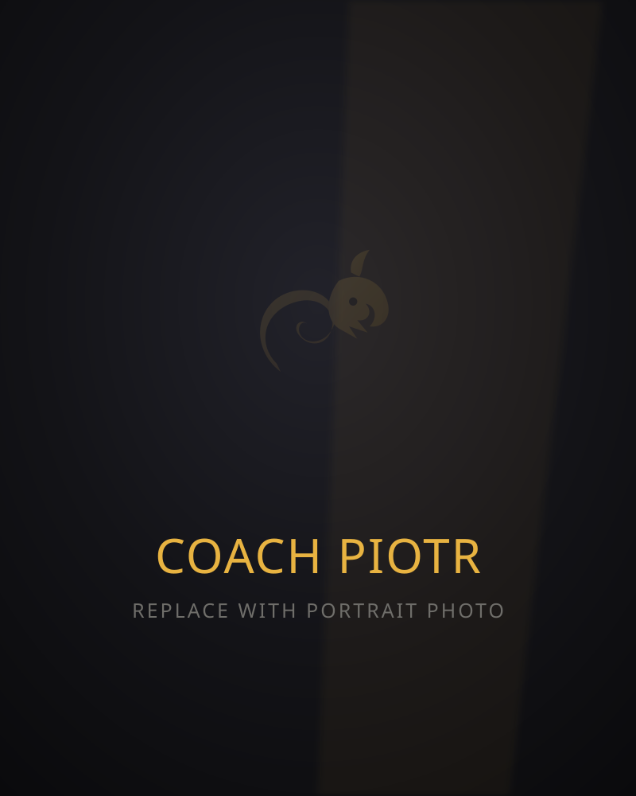

# Dragon Jiu-Jitsu Academy — Website

A fast, cinematic, single-page marketing site for **Dragon Jiu-Jitsu Academy**, Ballincollig, Cork.
Dark + gold brand, bold display typography, and smooth scroll-driven animations that stay
lightweight on any device.

Built as **static HTML/CSS/JS with zero dependencies and no build step** — it runs by opening
`index.html` and deploys to any static host as-is.

---

## Quick start

```bash
# just open it
open index.html            # macOS
# or serve locally (nicer for testing)
python3 -m http.server 8000    # then visit http://localhost:8000
```

Deploy by dragging the folder onto **Netlify**, importing to **Vercel**, or pushing to
**GitHub Pages** — no configuration required.

---

## Structure

```
index.html              All page content & sections
assets/
  css/style.css         All styling (design tokens at the top under :root)
  js/main.js            Scroll reveals, sticky storytelling, counters, mobile menu, form
  img/
    logo-mark.svg       Gold dragon emblem (nav + footer)
    favicon.svg         Browser tab icon
    hero.svg            Hero background        ← placeholder, replace
    coach-piotr.svg     Coach portrait         ← placeholder, replace
    why-1/2/3.svg       "Why Dragon" panels    ← placeholders, replace
```

---

## Swapping in real photos (the important bit)

Every photo slot currently uses a tasteful dark placeholder so the layout looks finished.
To drop in the real Dragon photos, **replace these files** (keep the filenames, or update the
`src` in `index.html`). Best results if you roughly match the aspect ratio and use dark/moody
images so the white text stays readable.

| File | Where it shows | Recommended | Suggested photo |
|------|----------------|-------------|-----------------|
| `assets/img/coach-piotr.svg` → `coach-piotr.jpg` | Coach section | ~800×1000, portrait | The black-belt studio portrait of Piotr |
| `assets/img/train-1.svg` → `train-1.jpg` | "Fundamentals that stick" | ~800×1000, portrait | Piotr coaching / teaching a technique |
| `assets/img/train-2.svg` → `train-2.jpg` | "A room that has your back" | ~800×1000, portrait | Group training / mat full of students |
| `assets/img/train-3.svg` → `train-3.jpg` | "Tested where it counts" | ~800×1000, portrait | The Milan Open podium shot |
| `assets/img/banner.svg` → `banner.jpg` | Full-bleed statement band | ~1920×1080, landscape | Wide, moody mat/action shot (white text sits on top) |

The gold **dragon crest** (`dragon-hero.svg` in the hero, `logo-mark.svg` in the nav/footer) is a
hand-built SVG. Swap in the gym's official logo any time by replacing those files.

**If you switch from `.svg` to `.jpg`/`.webp`,** update the matching `src="..."` in `index.html`
(search for the filename). Example:

```html
<!-- before -->

<!-- after -->

```

> **Tip:** For the hero, a `.jpg`/`.webp` will also work — the parallax and overlays are applied
> by CSS/JS regardless of format.

### Replacing the logo
The dragon emblem in `logo-mark.svg` is a clean stand-in built from the brand's gold-dragon
motif. If you have the official Dragon logo as an SVG or transparent PNG, drop it in as
`assets/img/logo-mark.svg` (or update the two `` references).

---

## Editing content

- **Timetable** — `index.html`, the `#timetable` section. Each day is a `.tt-day` block; edit the
  `<li>` rows (`.tt-time` = time, `.tt-class` = class name, `<em>` = age/level subtitle).
- **Coach bio** — `#coach` section. The bio text is a first draft — tweak Piotr's belt lineage,
  achievements, and story as you'd like it to read.
- **Programmes / Results copy** — `#programmes` and `#results` sections.
- **Contact details** — phone, address and socials appear in the footer and the `#contact` form
  note. Phone link uses `tel:+353858531940`; address links to Google Maps.
- **Brand colours** — `assets/css/style.css`, the `:root` block. `--gold` and `--red` drive the
  whole palette.

---

## The "Book free trial" form

The form (`#contact`) is **front-end only** — it validates and shows a friendly confirmation but
does not yet send anything. To make it actually deliver enquiries, point it at a form backend
(no server needed):

1. Create a free form endpoint (e.g. **Formspree**, **Basin**, or **Netlify Forms**).
2. In `index.html`, give the `<form data-trial-form>` an `action="<your-endpoint>"` and
   `method="POST"`, then either remove the `e.preventDefault()` in `assets/js/main.js` or use the
   provider's AJAX snippet.

Until then, the note nudges people to call **085 853 1940**.

---

## Accessibility & performance

- Semantic HTML, skip-link, visible focus states, `aria` labels on the menu.
- All motion respects **`prefers-reduced-motion`** — animations disable cleanly.
- Animations only use `transform`/`opacity` (GPU-friendly) and are throttled with
  `requestAnimationFrame`, so it stays smooth on phones.
- Images lazy-load; the only external request is Google Fonts (Anton / Oswald / Inter).
  To go fully offline/self-hosted, download those fonts and swap the `<link>` for local `@font-face`.
